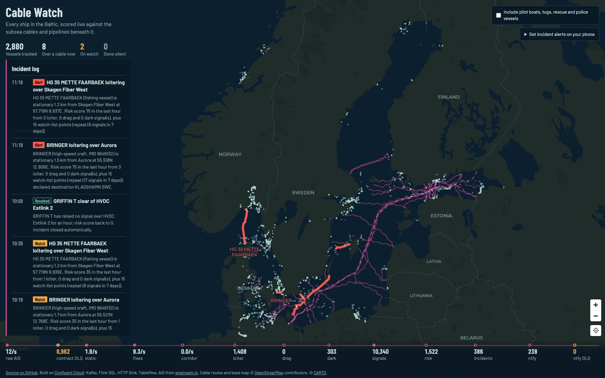
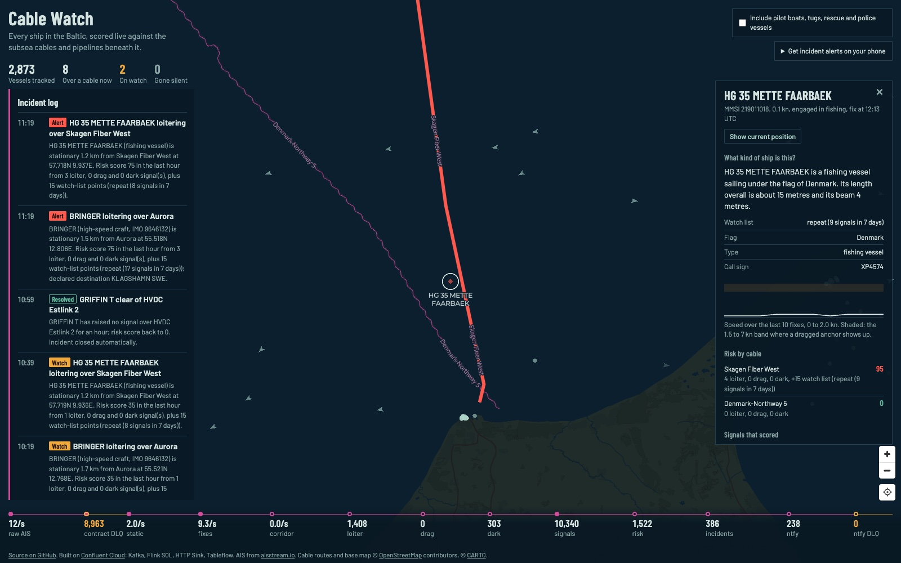
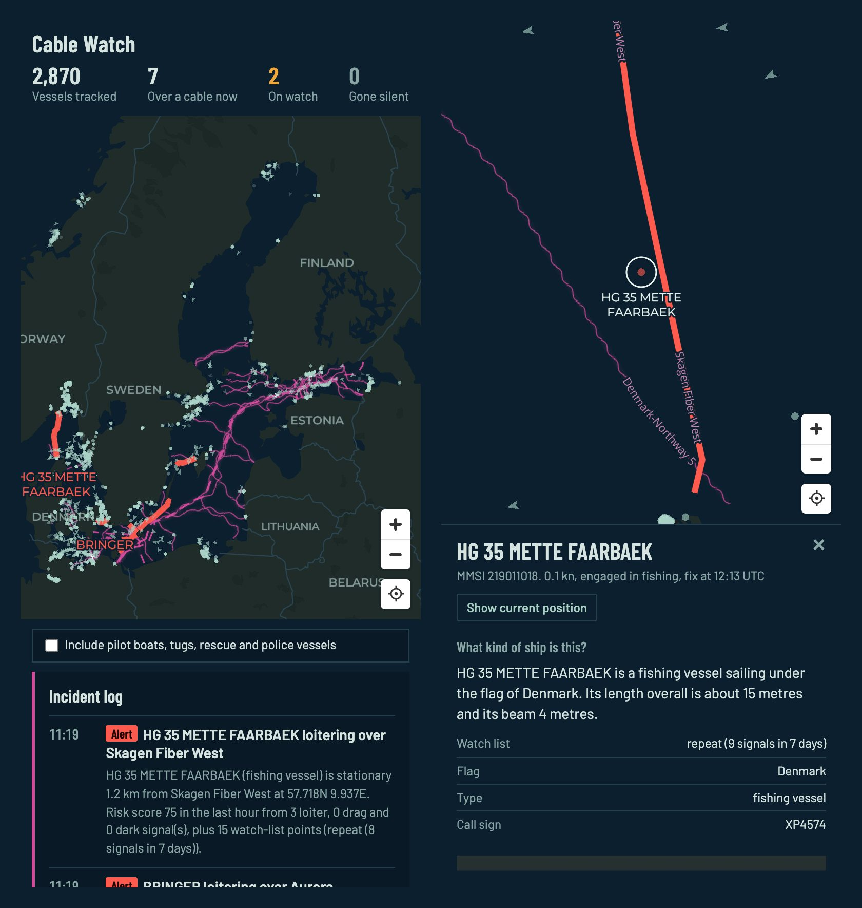

# Cable Watch: dark vessels over undersea infrastructure

Live ship positions from the Baltic stream through Confluent Cloud. Flink SQL
raises an incident when a vessel loiters or drags its anchor over a subsea
cable, or falls silent near one, and a fully managed HTTP Sink connector sends
the alert to your phone. No human in the loop between the ship's radio and the
notification.



## Why this demo

The Baltic Sea has had a run of subsea cable and pipeline damage:
Balticconnector (October 2023), C-Lion1 and BCS East-West (November 2024), and
Estlink 2 (December 2024). In each case the suspect vessel's behaviour was
visible afterwards in public AIS data: slow passage over the corridor, an anchor
dragged for tens of kilometres, gaps in the track.

None of these signals is in a single position report. They exist only across
time, per vessel, relative to a fixed geography. That is what stateful stream
processing is for, and it makes Confluent the whole product: ingest, contract,
enrich, detect, act and archive in one platform. The only code outside
Confluent is the AIS producer and the web page.

| | |
| --- | --- |
| **Continuous stream** | aisstream.io WebSocket over the Baltic: about 12 reports a second from roughly 3,000 vessels |
| **Stateful logic** | Flink SQL: temporal joins, tumbling, session and OVER windows, `MATCH_RECOGNIZE`, interval joins |
| **Automated outcome** | A fully managed HTTP Sink V2 connector posts push notifications (ntfy.sh); PagerDuty and Slack optional |
| **Live UI** | Nautical-chart map, incident log, vessel details, and the pipeline's topic rates |

## What you see

- **The chart.** Cables are magenta wavy lines and pipelines magenta dashes,
  as on a nautical chart. A cable turns amber when a vessel over it is on WATCH
  and pulses red at ALERT. Ships are coloured by risk score. A vessel that falls
  silent near a cable leaves a hollow ghost marker that counts the minutes.
  The crosshair under the zoom buttons recenters on the whole Baltic.
- **Counters.** Vessels tracked, over a cable now, on watch, gone silent. Click
  one to list those ships (the map dims the rest); click a ship to open it.
- **Incident log.** Every WATCH, ALERT and resolve, newest first, with a
  two-sentence brief. Click an entry to fly to where it happened.
- **Vessel panel.** What kind of ship it is ("SANDBORN (IMO 9965667) is a dredger
  sailing under the flag of Denmark..."), flag, call sign, destination and
  draught; a speed sparkline; its score per cable and any watch-list reason; the
  signals that scored. **Show current position** returns the map to the ship.
- **Pipeline strip.** Every topic from raw AIS to the notification, with its
  live rate or running total, including the DLQs.
- **Phone alerts.** A QR code subscribes your phone to the ntfy topic.
- **Service vessels.** Pilot boats, tugs, rescue and police vessels are hidden
  unless you tick the box (see [Service vessels](#service-vessels)).
- **On a phone.** The counters sit above the map, and the incident log and
  pipeline strip below it; the vessel panel slides up from the bottom.





## Architecture

```
aisstream.io (WebSocket)                          OpenStreetMap cable routes
        │                                                     │
  producer.py (Avro, H3 cell,                       tools/build_cables.py → loader.py
  data contract → DLQ)                                        │
        ▼                                                     ▼
 [ais_position_raw] ──► ais_position_dlq            [cable_cells] (compacted, H3 → cables)
 [vessel_static]  (ship name, type, size)
        │
 ┌──────┴──────────────────── Confluent Cloud Flink SQL ─────────────────────┐
 │ 20 clean + dedupe ─► [vessel_fixes] ──────────────────────► Tableflow      │
 │ 21 temporal join on H3 cell ─► [corridor_fixes]                            │
 │ 22 TUMBLE per vessel+cable, slow fixes ─► [loiter_events]                  │
 │ 23 MATCH_RECOGNIZE anchor drag ─► [drag_events]                            │
 │ 24 SESSION gap + interval join + temporal join ─► [dark_events]            │
 │ 25 union + points + heartbeat ─► [risk_signals]                            │
 │ 26 OVER score + watch list ∪ SESSION decay ─► [risk_updates]               │
 │ 28 upsert ─► [vessel_risk] ───────────────────────────────► Tableflow      │
 │ 29 state transitions + vessel_static join ─► [incidents] ─► Tableflow      │
 │ 32 ML_PREDICT brief (optional) ─► [incident_briefs]                        │
 │ 40-42 JSON bodies ─► [ntfy_events] [pagerduty_events] [slack_events]       │
 └───────────────────────────────────────────────────────────────────────────┘
        │                    │                       │
 HTTP Sink V2 ─► ntfy.sh   HTTP Sink V2 ─► PagerDuty   HTTP Sink V2 ─► Slack
        │
 FastAPI (SSE) ─► MapLibre dashboard
```

The numbers are the files in [`flink/`](flink); Terraform submits each one as a
`confluent_flink_statement`.

| Confluent component | Role in the demo |
| --- | --- |
| Kafka | Every stage is a topic; the dashboard's pipeline strip shows each one's rate |
| Schema Registry (Avro) | Flink's `CREATE TABLE` registers the schemas; the producer and loader write with them and never register their own |
| Data contracts | CEL rules on `ais_position_raw` send impossible fixes to a DLQ, from inside the producer's serializer |
| Flink SQL | All detection, scoring and payload building |
| Flink AI (`ML_PREDICT`) | Optional: rewrites each incident as a two-sentence brief |
| HTTP Sink V2 connector | The side effect; no custom consumer touches the notification |
| Tableflow | `vessel_fixes`, `vessel_risk` and `incidents` as Iceberg tables |
| Stream Lineage | The live graph from raw AIS to a notification (`make url` prints the link) |
| Stream Catalog tags | `geo`, `alerting` and `pii_free` on the topics |
| Terraform (`confluentinc/confluent`) | One `make infra` builds all of it, plus the AWS host |

## Run it

**You need:**
- A Confluent Cloud resource-management API key.
- A free [aisstream.io](https://aisstream.io) key.
- AWS credentials.
- Terraform 1.5+ and Python 3.11+.

```sh
cp .env.example .env                                              # fill in the three keys
cp terraform/terraform.tfvars.example terraform/terraform.tfvars  # optional settings
make infra
```

`make infra` takes about 15 minutes and builds:

- **On Confluent Cloud:** an environment with Stream Governance Advanced, a Basic
  Kafka cluster, the raw topic and its data contract, a Flink compute pool and
  every statement, the HTTP Sink connector(s), Tableflow and catalog tags.
- **On AWS:** one `t4g.small` instance behind CloudFront that loads the cable
  geography, runs the producer and serves the dashboard.

It ends by printing the links:

```
dashboard: https://<id>.cloudfront.net
ntfy:      https://ntfy.sh/cablewatch-<hex>
flink:     https://confluent.cloud/environments/<env>/flink/statements
lineage:   https://confluent.cloud/environments/<env>/clusters/<cluster>/stream-lineage/...
```

Give it a few minutes for ships to fill the map. Incidents follow at the pace of
real traffic: on the first day, about one an hour once service vessels were
excluded, so an empty incident log for a while is normal.

| Command | |
| --- | --- |
| `make url` | Print the links again |
| `make status` | Phase of every Flink statement |
| `make env` | Write `app/.env.app` from the Terraform outputs, for running the app locally |
| `make producer` / `make dashboard` | Run the producer or dashboard locally against the same cluster |
| `make cables` | Rebuild `app/data` from OpenStreetMap |
| `make destroy` | Tear everything down |

**Cost.** This runs metered Confluent Cloud resources (Stream Governance
Advanced, a Flink compute pool, a connector, Tableflow) and a small EC2 instance
with CloudFront. Run `make destroy` when you are done.

## Demo walkthrough

1. **The problem.** Open the dashboard. The magenta lines are the 47 cables and
   pipelines; the dots are every ship the feed hears right now. Mention the
   2023-2024 incidents: the evidence was in public AIS data, but only across time.
2. **The stream.** Point at the pipeline strip: raw AIS at about 12 a second,
   the contract DLQ already catching impossible reports, then each Flink stage.
3. **Detection.** Click **On watch** or the incident log. Open a vessel and show
   the signals that scored, the cable, and the ship description built from AIS.
4. **The outcome.** Scan the QR code. When the next WATCH or ALERT fires, phones
   buzz. Flink wrote the JSON and the HTTP Sink delivered it; no consumer code.
5. **Under the hood.** In Confluent Cloud, open the Flink statements, the Stream
   Lineage graph from `ais_position_raw` to `ntfy_events`, a DLQ record with its
   `__rule.name` header, and the Tableflow tables.
6. **The details that matter.** Pick a couple from
   [Lessons from running it on live data](#lessons-from-running-it-on-live-data);
   they show what event time and watermarks mean in practice.

## How the detection works

- **Clean and dedupe.** Base stations relay the same report, so `ROW_NUMBER()`
  keeps the first copy of each (vessel, AIS second, position). "Not available"
  heading and course become NULL.
- **Geofence as an equi-join.** The producer tags each fix with its H3 cell, and
  one event-time temporal join against `cable_cells` replaces any
  point-in-polygon work. Fixes within 2 km of a route are corridor fixes.
- **Loitering** is a 20-minute tumbling window per vessel and cable over
  corridor fixes under 2 knots. (A session window would only close once the ship
  left, so a vessel parked on a cable for hours would raise nothing.)
- **Anchor drag** is `MATCH_RECOGNIZE`: eight consecutive corridor fixes at 1.5
  to 7 knots, either reporting "at anchor" or moving more than 45° off the bow.
  That is the Eagle S signature.
- **Going dark** is a 30-minute session window per vessel over every fix. The
  session closes when the watermark passes the gap, and the watermark is driven
  by every other ship in the Baltic, so a silent vessel still gets a clock. An
  interval join fetches the session's last fix, and a temporal join checks that
  it was within 10 km of a cable. Only vessels under 3 knots when last heard
  count: aisstream.io's volunteer receivers are much sparser than commercial
  networks, and a ship that goes quiet while under way has almost always just
  sailed out of their range. "Gone silent" means *our feed* has not heard the
  ship; a site like MarineTraffic may still see it.
- **Score.** The sum of points over the last hour (an OVER window per vessel and
  cable). A one-hour session window over the signals emits the CLEAR that
  resolves the incident.

  | Signal | Points |
  | --- | --- |
  | Loitering over a corridor, per 20 minutes | 20 |
  | Anchor drag over a corridor | 50 |
  | Dark within 10 km of a cable | 40 |
  | Watch list, per reason (only with one of the above in the last hour) | 15 |

  NORMAL under 30, WATCH 30 to 59, ALERT 60 and over.
- **Incidents** are state transitions per vessel and cable (WATCH, ALERT,
  resolve), enriched with `vessel_static`. The payload statements turn them into
  the exact JSON each HTTP Sink posts; tapping the ntfy notification opens the
  vessel on the dashboard. Incidents older than 30 minutes are never sent.

### Watch list

A vessel that is already scoring gets 15 extra points for each of these reasons:

- **Flag** on the list: the flags of the suspect vessels in past Baltic incidents
  (Cook Islands, Hong Kong, China), and registries often reported in connection
  with the "shadow fleet" (Gabon, Comoros, Cameroon, Sierra Leone, Palau,
  Eswatini). The flag comes from the MMSI's first three digits.
- **Type:** a tanker, or a cargo ship broadcasting no destination.
- **Repeat offender:** 3 or more earlier signals over any cable in the past
  7 days (a 7-day OVER window per vessel).

The points apply only on top of behaviour, so no vessel is ever raised for who
it is. A listed tanker that goes dark near a cable scores 40 + 15 + 15 = 70 and
goes straight to ALERT, where an unlisted ship would be on WATCH. The reasons
appear in the brief, the notification and the vessel panel.

### Service vessels

Pilot vessels, tugs and towing vessels, search-and-rescue and law-enforcement
vessels wait over cables as part of their job. In the first day of live data,
three Helsinki pilot boats raised 27 of 31 incidents. Flink still scores them,
but they never get watch-list points, they are left out of notifications, and
the dashboard hides them unless **Include pilot boats, tugs, rescue and police
vessels** is ticked.

## Configuration

Secrets go in `.env`; everything else is a Terraform variable, set in
`terraform/terraform.tfvars` (see the example file).

| `.env` | |
| --- | --- |
| `CONFLUENT_CLOUD_API_KEY` / `_SECRET` | Required: Confluent Cloud resource-management key |
| `AISSTREAM_API_KEY` | Required: aisstream.io key |
| `OPENAI_API_KEY` | Optional: adds a Flink AI model; `ML_PREDICT` writes the incident briefs |
| `PAGERDUTY_ROUTING_KEY` | Optional: adds an HTTP Sink to the PagerDuty Events API v2; trigger and resolve share a `dedup_key`. PagerDuty takes the key in the request body, so it is part of the `pagerduty_events` records |
| `SLACK_WEBHOOK_URL` | Optional: adds an HTTP Sink posting a Block Kit message |

| Terraform variable | Default | |
| --- | --- | --- |
| `region` / `aws_region` | `eu-central-1` | Confluent Cloud and AWS regions |
| `ntfy_topic` | random | Fix it so phone subscriptions survive a rebuild |
| `notify_service_vessels` | `false` | Also notify for pilots, tugs, rescue and police vessels |
| `watch_flags` | see above | Flag list, as name => ITU MIDs |
| `watch_points` | `15` | Points per watch-list reason |
| `watch_repeat_signals` | `3` | Earlier signals in 7 days that make a repeat offender |
| `tableflow_enabled` | `true` | Materialise the Iceberg tables |
| `flink_max_cfu` | `20` | Upper bound for the Flink compute pool |
| `repo_url` | this repo | Source link on the dashboard; `""` hides it |
| `aws_profile` / `aws_tags` | | AWS credentials profile and extra tags |

## Data

### AIS

- `wss://stream.aisstream.io/v0/stream`, bounding box `[[53.5, 9.5], [66.0, 30.5]]`,
  message types `PositionReport`, `StandardClassBPositionReport` and `ShipStaticData`.
- Positions go to `ais_position_raw`, tagged by the producer with their H3
  resolution-7 cell. Static data (name, type, IMO, destination, dimensions) goes
  to the compacted `vessel_static`.
- Coverage is terrestrial, from volunteer receivers: dense in the Gulf of
  Finland and the Danish straits, sparse in the central Baltic.

### Cable corridors

[`tools/build_cables.py`](tools/build_cables.py) takes every named submarine
cable and pipeline in the box from OpenStreetMap: 47 assets (24 telecom, 19
power, 4 gas), including C-Lion1, Estlink 1 and 2, Balticconnector, BCS
East-West, NordBalt and Nord Stream. It buffers each route by 10 km, fills the
buffer with H3 resolution-7 cells (about 1.2 km edge) and records each cell's
distance to the route. Cells within 3 km of land are dropped, leaving 27,131
cells. The output is committed in `app/data`, so a deploy never depends on
Overpass being up.

**[CABLES.md](CABLES.md)** lists every asset with its operator, length and
corridor size, the incidents that motivated the demo, the limits of the OSM
data, and how to change the set.

### Data contract

`ais_position_raw` is the one topic Terraform creates rather than Flink: its
schema carries Schema Registry domain rules (CEL), with action `DLQ`:

```
message.lat >= -90.0 && message.lat <= 90.0
message.lon >= -180.0 && message.lon <= 180.0
message.mmsi >= 100000000 && message.mmsi <= 999999999
message.sog >= 0.0 && message.sog < 102.2
```

AIS uses 91 latitude, 181 longitude and 102.3 knots for "not available". The
Python client (confluent-kafka 2.16) runs the rules in the serializer and writes
failures to `ais_position_dlq`, with `__rule.*` headers naming the broken rule.

### Topics

| Topic | Key | Contents |
| --- | --- | --- |
| `ais_position_raw` | MMSI | Producer output, Avro, 24 h |
| `ais_position_dlq` | MMSI | Rejected by the data contract, JSON, 7 d |
| `vessel_static` | MMSI | Compacted: name, type, IMO, dimensions |
| `cable_cells` | H3 cell | Compacted: assets within 10 km of the cell and their distances |
| `vessel_fixes` | MMSI | Deduplicated, cleaned, event time; Tableflow |
| `corridor_fixes` | MMSI | Fixes within 2 km of a cable, once per cable |
| `loiter_events` / `drag_events` / `dark_events` | MMSI | One row per detection, 30 d |
| `risk_signals` | MMSI, cable | The detections with points, plus heartbeats |
| `risk_updates` | MMSI, cable | Every score change, with watch-list points |
| `vessel_risk` | MMSI, cable | Compacted: latest score and state; Tableflow |
| `incidents` | MMSI, cable | WATCH, ALERT and resolve transitions with a brief; Tableflow |
| `ntfy_events` / `pagerduty_events` / `slack_events` | none | Exact HTTP bodies for the sink connectors |
| `ntfy_events_dlq` (and the others) | | Calls the HTTP Sink could not deliver |

## Lessons from running it on live data

Each of these looked fine in a quick test and broke on the real feed.

- **Static reference data needs a far-future watermark.** A temporal join waits
  for the slower of its two inputs. `cable_cells` is written once with 2020
  timestamps, and reloading it pinned the joins to 2020: the whole pipeline
  downstream froze overnight. `00_alter_cable_cells.sql` sets its watermark a
  century ahead, so only `vessel_fixes` drives the clock. That is only safe with
  idleness detection off for the joining statements
  (`sql.tables.scan.idle-timeout = 0 ms`); otherwise, while `vessel_fixes` is
  idle at startup, the join's watermark jumps to the year 2119 and every later
  fix is dropped as late.
- **Sparse topics need a heartbeat.** Signals are rare, and an event-time
  operator only emits once a later row moves its watermark. Idleness detection
  does not help when the whole topic is quiet, so `risk_signals` also carries a
  heartbeat row every 30 seconds, from a tumbling window over `vessel_fixes`.
- **Checkpoints make output bursty.** Flink commits its Kafka transactions once
  per checkpoint, about a minute, and a keyed operator emits each burst in key
  order, not time order. `risk_signals` allows 3 minutes of lateness and
  `risk_updates` 2; these allowances are most of the delay before a notification.
- **One writer per topic.** The running score and the decay were once two
  statements writing `risk_updates`. Their transactions committed at different
  checkpoints, rows interleaved out of order, and the incident statement dropped
  the "late" ones. They now run as one statement (`UNION ALL`).
- **`LAG` is unsafe with ties.** It uses a RANGE frame, where two updates with
  the same timestamp see each other. Transitions use a two-row `ROWS` frame
  (`FIRST_VALUE ... ROWS BETWEEN 1 PRECEDING AND CURRENT ROW`).
- **`LAST_VALUE` is not allowed in session windows** on Confluent Cloud, so the
  dark detector fetches the last fix with an interval join.
- **Adding a column means evolving the schema.** Confluent Cloud Flink cannot
  `ALTER TABLE ... ADD` a physical column. Registering a new, backward-compatible
  Avro schema version in Schema Registry (optional field, default null) works,
  and Flink picks it up.
- **A free feed has coverage holes.** A cargo ship at 7.5 knots in the Kattegat
  was flagged as dark while MarineTraffic still saw it: aisstream.io had simply
  stopped hearing it. Hence the 3-knot rule for dark vessels.

## Operating notes

- Changing a statement's SQL replaces it, and the new statement re-reads its
  inputs from the earliest offset. Transitions are robust to the duplicates, and
  the payload statements never send an incident older than 30 minutes, so nobody
  is paged for history. The dashboard treats any risk state older than an hour
  as normal for the same reason.
- The dashboard reads Flink output with `isolation.level=read_uncommitted`, so
  the map draws rows as they are written rather than once per checkpoint.
- `make status` lists every statement's phase. The Confluent Metrics API
  (`io.confluent.flink/current_input_watermark_milliseconds`, grouped by
  statement) is the quickest way to find a stalled one.

## Repository layout

```
app/          producer, cable loader, dashboard server (FastAPI) and web page
app/data/     cable routes and H3 cells, built from OpenStreetMap
flink/        every Flink SQL statement, numbered in pipeline order
terraform/    Confluent Cloud and AWS, in one root module
tools/        build_cables.py (make cables)
scripts/      flink-status.sh (make status)
docs/         screenshots
```

## Not built yet

- **A coverage-hole model** to down-weight dark events where receivers are sparse.
- **Replay from Tableflow** of a recorded incident window. (An earlier version
  replayed a synthetic Eagle S track on demand; it was removed because anyone
  with the dashboard URL could send notifications to every subscriber.)

## Data and licences

- AIS: [aisstream.io](https://aisstream.io).
- Cable and pipeline routes: © OpenStreetMap contributors,
  [ODbL](https://www.openstreetmap.org/copyright). Land mask: Natural Earth (public domain).
- Base map: © CARTO, © OpenStreetMap contributors.
